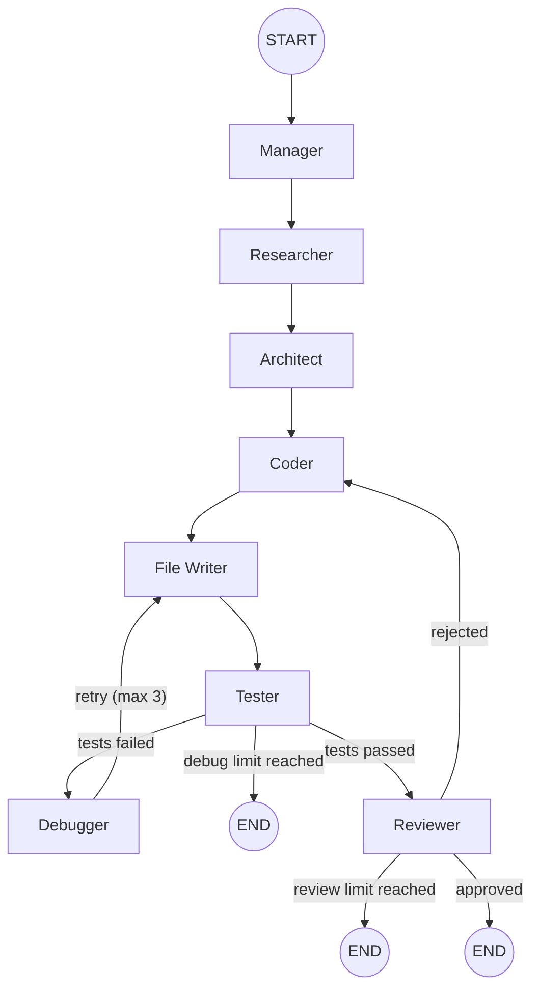

# AI Software Development Team

An autonomous, multi-agent AI software engineering pipeline built with **LangGraph**, **LangChain**, and **Pydantic**.
It simulates a full software development department by coordinating specialized AI agent personas in a state graph, transforming a plain-language software specification into working code — with planning, research, architecture design, coding, testing, review, and self-debugging.


---

## Table of Contents

- [Overview](#overview)
- [Features](#features)
- [Architecture](#architecture)
- [Agent Responsibilities](#agent-responsibilities)
- [Project Structure](#project-structure)
- [Prerequisites](#prerequisites)
- [Installation](#installation)
- [Configuration](#configuration)
- [Usage](#usage)
- [Workflow Details](#workflow-details)
- [Generated Output](#generated-output)
- [Testing](#testing)
- [Observability](#observability)
- [Current Status & Known Behavior](#current-status--known-behavior)
- [Contributing](#contributing)

---

## Overview

The pipeline takes a single user request — for example, _"Build a FastAPI backend for a simple task management application"_ — and runs it through a team of AI agents, each with a distinct role and a strict, Pydantic-validated output contract. The agents collaborate through a shared `AgentState` object managed by a LangGraph `StateGraph`, with conditional routing that enables automatic repair loops:

- **Self-debugging**: if syntax checks or tests fail, the Debugger agent rewrites the code and the pipeline re-tests (up to 3 attempts).
- **Self-review**: a Reviewer agent audits cross-layer consistency (request → plan → research → architecture → code → tests) and can send the project back to the Coder for revision (up to 3 attempts).

The result is a complete, runnable project written to `generated_projects/generated_project/`, along with structured test and review reports.

## Features

- **Multi-agent orchestration** — LangGraph `StateGraph` coordinates seven specialized agents plus file-writing and testing tools.
- **Structured outputs** — every agent returns Pydantic-validated JSON (`ManagerPlan`, `ResearchResult`, `ArchitecturePlan`, `GeneratedProject`, `ReviewResult`).
- **Autonomous repair loops** — bounded debug and review cycles with explicit attempt counters.
- **Real validation** — `py_compile` syntax checks, isolated virtual environment creation, dependency installation, and `pytest` execution inside the generated project.
- **Safe file writing** — path traversal protection and `.venv`-preserving cleanup in the output directory.
- **LLM-robust parsing** — tolerant JSON extraction for responses wrapped in Markdown fences or stray text.
- **LangSmith integration** — tracing enabled via environment variables.
- **Configurable models** — each agent pins its own Ollama model and temperature.

## Architecture

The state machine is defined in `app/graph/workflow.py`:



<details>
<summary>Text version of the workflow</summary>

```text
[START]
   |
   v
[Manager]    (Requirements, task breakdown, assigned agents, risks)
   |
   v
[Researcher] (Technical findings, recommendations, technologies, risks)
   |
   v
[Architect]  (Components, files, data flow, technical decisions)
   |
   v
[Coder]      (Generates complete code files as JSON)
   |
   v
[File Writer](Writes files to generated_projects/generated_project/)
   |
   v
[Tester]     (py_compile syntax check, isolated venv, pytest)
   |-- Tests fail  -> [Debugger] -> [File Writer]  (max 3 loops)
   |-- Tests pass  -> [Reviewer]
                          |-- Approved   -> [END] (success)
                          |-- Rejected   -> [Coder] (max 3 loops)
```

</details>

An editable diagram of the same flow is available in `workflow.excalidraw`.

## Agent Responsibilities

All agents live in `app/agents/`:

| Agent           | File                       | Model                | Responsibility                                                                                                                                                   |
| --------------- | -------------------------- | -------------------- | ---------------------------------------------------------------------------------------------------------------------------------------------------------------- |
| **Manager**     | `app/agents/manager.py`    | `gemma4:31b-cloud`   | Entry point. Analyzes the request, extracts requirements, builds a task breakdown with assigned agents, and flags early risks (`ManagerPlan`).                   |
| **Researcher**  | `app/agents/researcher.py` | `gemma4:31b-cloud`   | Evaluates the plan and produces technical findings, library recommendations, technology choices, and risks (`ResearchResult`).                                   |
| **Architect**   | `app/agents/architect.py`  | `gemma4:31b-cloud`   | Designs the component breakdown, file list, data flow, and technical decisions (`ArchitecturePlan`).                                                             |
| **Coder**       | `app/agents/coder.py`      | `gpt-oss:120b-cloud` | Generates complete, runnable Python source files as JSON (`GeneratedProject`), incorporating reviewer feedback on revision loops.                                |
| **File Writer** | `app/tools/file_tools.py`  | —                    | Safely writes generated files to disk, preventing directory traversal and preserving existing virtual environments.                                              |
| **Tester**      | `app/tools/test_tools.py`  | —                    | Compiles all Python files with `py_compile`, creates an isolated `.venv`, installs dependencies, and runs `pytest` on `test_*.py` / `*_test.py` files.           |
| **Debugger**    | `app/agents/debugger.py`   | `gemma4:31b-cloud`   | Triggered on failure; rewrites the project based on compiler/test output and keeps unaffected files intact.                                                      |
| **Reviewer**    | `app/agents/reviewer.py`   | `gemma4:31b-cloud`   | Cross-layer audit of request, plan, research, architecture, code, and test results; returns `approved` plus categorized, severity-rated issues (`ReviewResult`). |
| _Planner_       | `app/agents/planner.py`    | `gemma4:31b-cloud`   | _Dormant._ Legacy planning agent (`DevelopmentPlan`); its node is commented out in `workflow.py` while the Manager covers its role.                              |

## Project Structure

```text
ai-software-development-team/
├── app/
│   ├── main.py                 # Pipeline entry point
│   ├── agents/
│   │   ├── schemas.py          # Pydantic output contracts
│   │   ├── manager.py          # Manager agent
│   │   ├── researcher.py       # Researcher agent
│   │   ├── architect.py        # Architect agent
│   │   ├── coder.py            # Coder agent
│   │   ├── debugger.py         # Debugger agent
│   │   ├── reviewer.py         # Reviewer agent
│   │   └── planner.py          # Planner agent (dormant)
│   ├── graph/
│   │   ├── nodes.py            # Graph node functions
│   │   └── workflow.py         # StateGraph definition & routing
│   ├── state/
│   │   └── state.py            # AgentState TypedDict
│   └── tools/
│       ├── file_tools.py       # Safe project file writing
│       └── test_tools.py       # Syntax checks & pytest runner
├── generated_projects/         # Output directory (per-run)
│   └── generated_project/
├── tests/                      # Smoke scripts for agents/tools
├── .env                        # LangSmith config (gitignored)
├── pyproject.toml              # Project metadata & dependencies
├── requirements.txt            # Pip dependency list
├── uv.lock                     # uv lockfile
├── workflow.excalidraw         # Editable workflow diagram
└── CURRENT_STATUS.md           # Development log
```

## Prerequisites

- **Python 3.12+** (pinned in `.python-version`)
- **[Ollama](https://ollama.com)** running locally on the default endpoint (`http://localhost:11434`)
- The two models used by the agents:

```bash
ollama pull gemma4:31b-cloud
ollama pull gpt-oss:120b-cloud
```

## Installation

```bash
# Clone the repository
git clone <repo-url>
cd ai-software-development-team

# Option A: uv (recommended — lockfile included)
uv sync

# Option B: pip
python -m venv .venv
# Windows
.venv\Scripts\activate
# macOS / Linux
source .venv/bin/activate
pip install -r requirements.txt
```

## Configuration

Create a `.env` file in the project root (it is gitignored) to enable LangSmith tracing:

```ini
LANGSMITH_TRACING=true
LANGSMITH_API_KEY=your_api_key_here
LANGSMITH_PROJECT=ai-software-development-team

# Optional: point langchain-ollama at a remote Ollama server
# OLLAMA_BASE_URL=http://localhost:11434
```

Model selection and temperature are set per agent in `app/agents/*.py` (`ChatOllama(model=..., temperature=0)`).

## Usage

Run the pipeline from the repository root:

```bash
python app/main.py
```

The request being processed is defined in `app/main.py:21-24` — edit the `request` string to generate a different project:

```python
request = """
Build a FastAPI backend for a simple task management application.
Users should be able to create, read, update, and delete tasks.
"""
```

A successful run prints each stage's structured output:

```text
=== PROJECT SUMMARY ===
...
=== FINAL REQUIREMENTS ===
- Users can create tasks
- Users can read tasks
...
=== TASK BREAKDOWN ===
[Researcher] Task 1: Evaluate backend stack options
[Architect]  Task 2: Design component layout
...
=== GENERATED FILES ---
--- main.py ---
...
=== PROJECT ROOT ===
.../generated_projects/generated_project
=== TEST RESULTS ===
TEST PASSED
PASS Syntax: main.py
PASS Syntax: models.py
INFO: No test files found. Syntax checks passed.
=== REVIEW RESULTS ===
approved=True ...
=== FINAL STATUS ===
review_approved
Review Attempts: 1
Debug Attempts: 0
```

## Workflow Details

**State** (`app/state/state.py`) — a `TypedDict` shared by every node:

| Field               | Type                       | Description                              |
| ------------------- | -------------------------- | ---------------------------------------- |
| `user_request`      | `str`                      | Original software specification          |
| `manager_plan`      | `ManagerPlan \| None`      | Manager's structured plan                |
| `development_plan`  | `DevelopmentPlan \| None`  | Legacy planner output (currently unused) |
| `research`          | `ResearchResult \| None`   | Researcher findings                      |
| `architecture_plan` | `ArchitecturePlan \| None` | Architect's design                       |
| `generated_files`   | `dict[str, str] \| None`   | Map of file path → file content          |
| `project_root`      | `Path \| None`             | Directory where files were written       |
| `test_results`      | `str \| None`              | Tester report                            |
| `review`            | `ReviewResult \| None`     | Reviewer verdict                         |
| `errors`            | `list[str]`                | Accumulated error messages               |
| `debug_attempts`    | `int`                      | Debug loop counter (limit: 3)            |
| `review_attempts`   | `int`                      | Review loop counter (limit: 3)           |
| `status`            | `str`                      | Current pipeline stage                   |

**Routing** (`app/graph/workflow.py`):

- `route_after_testing` — sends failing projects to the `debugger` (while `debug_attempts < 3`), passing projects to the `reviewer`, and ends the run when the debug limit is reached.
- `route_after_review` — ends the run on approval, returns rejected projects to the `coder` (while `review_attempts < 3`), and ends the run when the review limit is reached.

Because the `debugger` and `reviewer` loops route back through `file_writer` and `tester`, every revision is re-written and re-validated automatically.

## Generated Output

Completed projects are written to `generated_projects/generated_project/`. For the default task-manager request this typically includes:

- `main.py` — FastAPI routes for task CRUD operations
- `models.py` — data models
- `repository.py` — in-memory repository with UUID keys
- `schemas.py` — Pydantic request/response schemas
- `requirements.txt` — dependencies for the generated app
- `tests/test_*.py` — pytest test files (the Coder prompt mandates generating them)

The directory is cleaned before each run, but any `.venv` inside it is preserved to avoid reinstalling dependencies on every iteration.

## Testing

The repository's own smoke scripts live in `tests/`:

```bash
pytest tests/
```

> Note: `tests/test_debugger.py` and `tests/test_test_tools.py` call the agents and tools directly, so they require a running Ollama instance with the configured models.

## Observability

With `LANGSMITH_TRACING=true` in `.env`, every LLM call is traced to the `ai-software-development-team` LangSmith project, making it easy to inspect prompts, structured outputs, and token usage per agent.

## Current Status & Known Behavior

The pipeline is a working prototype (`v0.1.0`). Two behaviors observed during development are documented in `CURRENT_STATUS.md`:

1. **Test-file generation depends on the prompt.** Earlier runs produced no `test_*.py` files because the user request did not ask for tests, the Planner/Architect did not plan them, and the Coder prompt only said _"Include tests when appropriate."_ The Tester then reported `INFO: No test files found. Syntax checks passed.` and returned `TEST PASSED` after syntax checks alone. The Coder prompt has since been tightened to **always** generate a `tests/` directory and to include `pytest`, `pytest-asyncio`, `httpx`, `fastapi`, and `uvicorn` in the generated `requirements.txt`.

2. **Syntax checks do not prove correctness.** The Tester's fallback means a project with zero test files passes on `py_compile` results alone. The Reviewer is explicitly instructed _not_ to approve a project merely because it compiles, and to weigh cross-layer consistency instead.

## Contributing

Contributions are welcome. To add a new agent to the team:

1. Define its output contract in `app/agents/schemas.py` (Pydantic `BaseModel`).
2. Implement the agent in `app/agents/<agent>.py` — prompt + `json.loads` + `Model.model_validate`.
3. Add a node function in `app/graph/nodes.py` that reads from and returns `AgentState`.
4. Register the node and its edges (including any conditional routing) in `app/graph/workflow.py`.
5. Add new state keys to `AgentState` in `app/state/state.py` if needed.

General guidelines:

- Follow PEP 8 and the existing module layout.
- Agents must return **only valid JSON** matching their schema — no Markdown fences, no prose.
- Keep prompts deterministic (`temperature=0`) for reproducible pipelines.
- Run `pytest tests/` before submitting a pull request.
- Update `CURRENT_STATUS.md` and this README when the workflow changes.

Pull request process:

1. Fork the repository and create a feature branch (`git checkout -b feature/agent-name`).
2. Commit your changes with a clear message.
3. Open a pull request describing the change and its effect on the pipeline.

---

_Project version 0.1.0 · Built with LangGraph, LangChain Ollama, and Pydantic._
